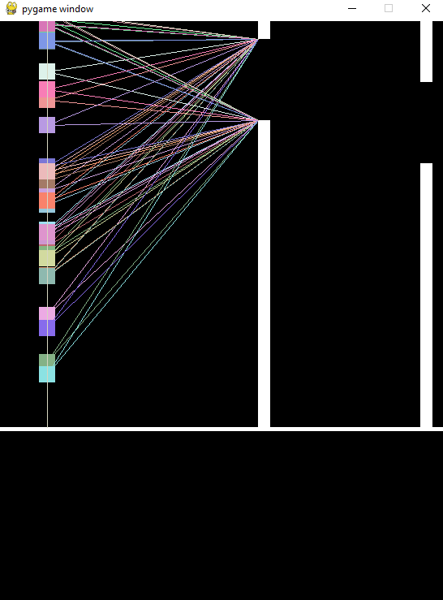

# Flap-Bird-NEFT

## Visão geral

O **Flap-Bird-NEFT** é um projeto de treinamento de redes neurais por neuroevolução para jogar uma versão simplificada de Flappy Bird. A cada geração, uma população de 200 agentes é avaliada pelo tempo de sobrevivência na partida, agrupada em espécies por similaridade de pesos e renovada por seleção natural e mutação.

O projeto é voltado para estudantes e pessoas desenvolvedoras que querem acompanhar, no código, como funcionam uma rede neural feedforward e um ciclo evolutivo com especiação sem depender de frameworks de aprendizado profundo. Toda a matemática da rede é implementada diretamente sobre arrays e multiplicações matriciais.



## Tecnologias utilizadas

- **Python 3.12:** linguagem usada no desenvolvimento do projeto 
- **Pygame:** gerenciamento da janela (`550x720`), loop de jogo a 60 FPS, detecção de colisões e renderização dos pássaros, canos, chão e linhas de visão dos agentes.
- **NumPy:** operações matriciais das camadas densas, funções de ativação, cálculo de distâncias euclidianas dos sensores e aplicação de mutações nos pesos.

## Instalação

### Pré-requisitos

- Python `3.12` 
- `pip`
- Git

### Passo a passo

1. Clone o repositório e entre na pasta do projeto:

```bash
git clone https://github.com/gabidraowork/Flap-Bird-NEFT.git
cd Flap-Bird-NEFT
```

2. Crie e ative um ambiente virtual:

```bash
python -m venv .venv
```

No Linux ou macOS:

```bash
source .venv/bin/activate
```

No Windows (PowerShell):

```powershell
.venv\Scripts\Activate.ps1
```

3. Instale as dependências (`pygame` e `numpy`):

```bash
pip install pygame numpy
```

*(Nota: o repositório ainda não possui um arquivo `requirements.txt`; caso adicione um posteriormente, atualize este comando para `pip install -r requirements.txt`.)*

4. Variáveis de ambiente:

O projeto não utiliza variáveis de ambiente nem serviços externos. Os parâmetros da simulação (tamanho da janela e tamanho da população) ficam definidos diretamente em `config.py`.

## Uso

Para iniciar a simulação e o treinamento, execute o script principal na raiz do repositório:

```bash
python main.py
```

### Comportamento e parâmetros

- Ao iniciar, uma janela do Pygame é aberta exibindo os 200 agentes da geração atual (quadrados coloridos) com linhas ligando cada pássaro ao próximo cano e ao chão.
- Cada agente recebe 4 entradas normalizadas (distância ao cano superior, distância ao cano inferior, distância ao chão e velocidade vertical) somadas a um termo de bias, passando por uma rede `5 -> 2 -> 1` com ativação `Sigmoid`. Quando a saída é maior ou igual a `0.75`, o pássaro salta.
- Quando todos os agentes da geração colidem com o chão ou com os canos, o loop limpa os obstáculos, executa a seleção natural e exibe no terminal as etapas de transição para a próxima geração:

```text
SPECIATE
CALCULATING FITNESS
KILL EXTINTIC
KILL STALE
SORT BY  FITNESS
CHILDREN FOR NEXT GEN
```

- Para alterar a resolução da janela (`win_width`, `win_height`) ou a quantidade de agentes por geração (`population_size`), edite os valores em `config.py` antes de executar `python main.py`.
- Para encerrar o treinamento, feche a janela do Pygame.

## Estrutura do projeto

```text
Flap-Bird-NEFT/
├── main.py             # Loop principal do jogo, geração de canos e controle das gerações
├── config.py           # Configurações da janela, população inicial e objetos globais da partida
├── components.py       # Entidades Ground (chão) e Pipes (canos e movimentação)
├── player.py           # Física do pássaro, colisões, sensores de visão, decisão e fitness
├── brain.py            # Arquitetura da rede neural (5 -> 2 -> 1), clonagem e mutação dos pesos
├── population.py       # Gerenciamento da população, especiação e seleção natural
├── species.py          # Agrupamento por similaridade de pesos, estagnação e reprodução
├── connection.py       # Arquivo atualmente vazio (reservado para uso futuro)
└── NN/                 # Módulo próprio de camadas e funções de ativação em NumPy
    ├── layer.py        # Classe base Layer
    ├── dense.py        # Camada totalmente conectada (Dense)
    ├── activation.py   # Classe base para funções de ativação
    ├── sigmoid.py      # Ativação Sigmoid (usada na rede atual)
    ├── ReLU.py         # Ativação ReLU
    ├── tanh.py         # Ativação Tanh
    └── softmax.py      # Ativação Softmax
```

*(Nota: caso salve a captura de tela em uma pasta como `assets/`, inclua essa pasta na árvore acima. O repositório também contém pastas `__pycache__/` versionadas atualmente; considere adicionar um `.gitignore` para removê-las do controle de versão.)*

## Contribuições

Contribuições para correção de bugs, ajustes na simulação ou melhorias na estrutura do código são bem-vindas.

1. **Issues:** antes de iniciar uma mudança maior, abra uma issue em [Issues do repositório](https://github.com/gabidraowork/Flap-Bird-NEFT/issues) explicando o comportamento observado (com passos para reprodução) ou a alteração proposta.
2. **Branches:** crie uma branch a partir da `main`:

```bash
git checkout -b [prefixo/descricao-curta, ex: fix/colisao-cano]
```

3. **Commits:** utilize mensagens claras e objetivas seguindo `[padrão de commits adotado, ex: Conventional Commits — feat:, fix:, docs:, refactor:]`.
4. **Código e testes:**
   - Siga o padrão `PEP 8` para formatação em Python.
   - Mantenha o projeto restrito às dependências `pygame` e `numpy`, salvo alinhamento prévio em issue.
   - O repositório ainda não possui suíte de testes automatizados; antes de abrir um PR, execute `python main.py` localmente para confirmar que o loop da simulação e a transição entre gerações continuam funcionando sem erros (ou rode `[comando de testes, caso venha a ser adicionado]`).
5. **Pull Request:** abra o PR descrevendo o que foi alterado, o motivo da mudança e referenciando a issue correspondente, se houver.
